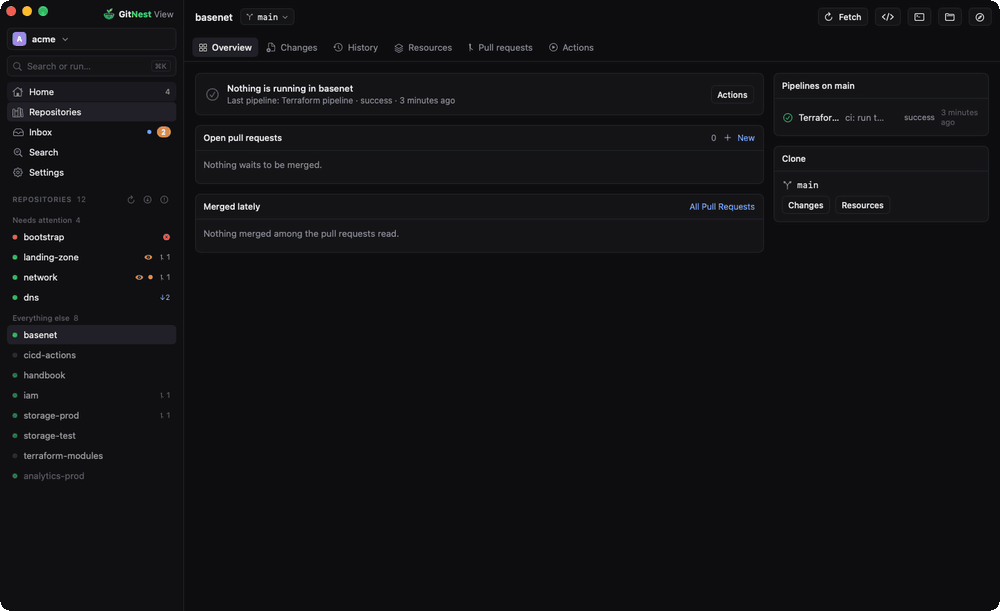

# GitNest View

**Every git repository of your team on one screen: a native Mac app for Forgejo, Gitea, GitLab and GitHub.**



GitNest View clones the repositories of an organisation or group, keeps them
fetched, and shows you what needs you. That covers failed pipelines, reviews
asked of you, your pull requests, and commits to pull or push. You can do the
work from the same window. It is the desktop sibling of
[gitnest](https://github.com/Paksonite/gitnest), the terminal UI, and runs on
gitnest's own git engine.

- **Home: what needs you today.** A failed pipeline on the default branch,
  your failing pull request, a review waiting for you, branches to pull or
  push, uncommitted work. Each one has a single button to deal with it.
- **A git client per repository.** Stage files or single lines, commit,
  amend and push. Browse the whole file tree with the changed files marked.
  Edit history (reword, squash, fixup, drop, revert) with undo for every
  rewrite. Manage branches, tags and stashes.
- **Pull requests where you work.** Reviews and the approvals the branch
  protection needs, checks, commits, files and the diff. Open a pull request
  with its diff, and get a warning when it deletes something. Merge,
  rebase, draft, reviewers and labels.
- **Pipelines with live logs.** Forgejo Actions, GitLab CI/CD and GitHub
  Actions. Job logs are coloured and split into steps, and they follow a
  running job. Start a workflow with its inputs, re-run or cancel, all
  without a browser. The Terraform / OpenTofu plan is read straight from
  the log.
- **Across repositories at once.** Pull all (fast-forward every branch that
  is behind, with the incoming commits listed), clone a whole workspace,
  release pull requests (develop → main) in every repository, and search
  the code of every clone.
- **Inbox, menu bar and notifications.** Review requests and your own pull
  requests from every connected server, a menu bar item with quick actions,
  and macOS notifications.
- **Jira, if you use it.** Tickets from your filter, their status, people,
  links, sprint and time tracking, in the app's own window.

## Install

Apple silicon, macOS 14 or newer. With Homebrew:

```sh
brew install --cask paksonite/tap/gitnest-view
```

Homebrew may ask you to trust the tap first (`brew trust paksonite/tap`).
You can also download the DMG from
[Releases](https://github.com/Paksonite/gitnest-view/releases). The app
updates itself: **GitNest View → Check for Updates…**.

The app needs `git` (it comes with the Xcode Command Line Tools:
`xcode-select --install`).

## Quick start

1. **Connect a server.** On first launch the app asks for a server address
   and an access token. It works out whether the server is Forgejo/Gitea,
   GitLab or GitHub, and you can also pick the kind yourself. The token
   page link takes you to the right place on the server.
2. **Choose a folder** for the clones (for example `~/GitNest`) and a
   **workspace**: an organisation, a group, or your own repositories.
3. **Clone** one repository or all of them (**Get all repositories…**).
   Existing clones in the folder are picked up as they are.

Press **⌘K** from anywhere to jump to a repository, pull request, branch or
workflow, or to run a command.

### Tokens

| Server | Token | Scopes |
|---|---|---|
| Forgejo / Gitea | Settings → Applications | read: repository, organisation, issue, user; write: repository (to open pull requests, run and re-run workflows) |
| GitLab (self-hosted or gitlab.com) | Preferences → Access tokens | `api` (`read_api` to look only) |
| GitHub / GitHub Enterprise | Settings → Developer settings → Tokens | classic: `repo`, `read:org`, `workflow`, `notifications`; or a fine-grained token |

A read-only token works too: the app shows what it can do and greys out the
rest. You can connect several servers; the Inbox shows all of them or the
one you pick.

Tokens are kept in the macOS Keychain. With HTTPS remotes the same token is
used for git, passed to git per command and never written into a clone. If
you prefer SSH keys, switch **Clone with** in Settings → Servers.

## Good to know

- **The Keychain question after an update.** The app is signed with its own
  certificate (it has no Apple Team ID), so macOS asks once after each
  update before the new version may read the tokens. Enter your login
  password and choose **Always Allow**. Since 0.1.10 all tokens share one
  Keychain item, so it is one question per update, not one per server.
- **Re-running pipelines on Forgejo 16.** Forgejo added the API for
  re-running jobs in version 17. On older servers the app re-runs them
  through the server's web pages: the first time, it asks you to sign in
  once in its own window. The session stays in the app; Settings → Servers
  shows it and can sign you out.
- **What it changes on its own.** Nothing on the server. Locally it fetches
  every 10 minutes (Settings → General can turn it off); it never pulls,
  rebases or pushes without you clicking.
- **Requirements.** Forgejo 16 or newer, a recent GitLab, or GitHub.

## Build from source

Needs Xcode 16+, [XcodeGen](https://github.com/yonaskolb/XcodeGen) and Go 1.25+
(`brew install xcodegen go`).

```sh
scripts/install.sh # build, sign with the GitNest View certificate, install into /Applications
scripts/build.sh   # → build.noindex/GitNest View.app
scripts/test.sh    # the engine's tests, then the app's
```

`GitNestView.xcodeproj` is generated from `project.yml` and is not committed;
run `xcodegen generate` to open it in Xcode. Releasing:
[docs/releasing.md](docs/releasing.md).

| Path | What |
|---|---|
| `App/` | the macOS app (Swift, SwiftUI with AppKit where it matters) |
| `App/Core` | talks to the engine: JSON-RPC over the engine's stdin/stdout |
| `App/Forge` | `ForgeService` and its three clients (Forgejo/Gitea, GitHub, GitLab; see `docs/backendy-serwerow.md`), accounts, the web session for Forgejo before 17, logs, Terraform plan and error parsing |
| `App/Model` | the app's state: `AppModel`, work on clones (`LocalWork`), what needs attention, notifications |
| `App/Views` | the window, Home, the repository tabs, ⌘K, sheets, menu bar item |
| `core/` | the engine, `gitnest-core` (Go): gitnest's `gitx`, `scan`, `config` and `state` packages plus `internal/rpc`, `internal/workflow` and the methods in `cmd/gitnest-core` |
| `design/` | the logo and the app icon (SVG); `scripts/make-icon.sh` renders them |
| `Tests/`, `UITests/` | the app's tests; the `Live…` tests run against real servers when `TEST_RUNNER_GNV_*` is set, the UI tests through `scripts/ui-test.sh` |

Signing: `scripts/sign.sh` uses `~/.config/paksonite-gitnest-view/signing.p12`
(or `SIGNING_P12_BASE64` in CI), a self-signed certificate, so the app keeps
one identity across builds; without it the app is signed ad hoc and macOS
asks for the Keychain after every build.

The demo above is recorded by `UITests/ClickThroughTests.testDemoTour` against
a demo organisation, with the window filmed from outside.

License: [MIT](LICENSE).
